# Lab 3 — Teardown, and the same machine from the command line

**Course:** Operating System Architecture · **Week 4** · **CLO 1**

The first half is a teardown on paper: ten real products, read from their makers' websites.
The second half reads CPU, memory and disk specifications from the command line on two operating systems and compares how each one names the same fact.

```
labs/lab03-teardown/
├── README.md
└── evidence/
    ├── photos/              ← screenshots of each maker's product page
    ├── windows-specs.txt    ← raw output, host laptop (Windows 11)
    └── linux-specs.txt      ← raw output, Ubuntu VM in VirtualBox
```

---

## Part 1 — The ten components

Each caption follows the same pattern: **what it is → what it connects to → what limits it.**
Every screenshot is taken from the maker's own page (linked under each part).

### Processors

#### AMD Ryzen 5 7600
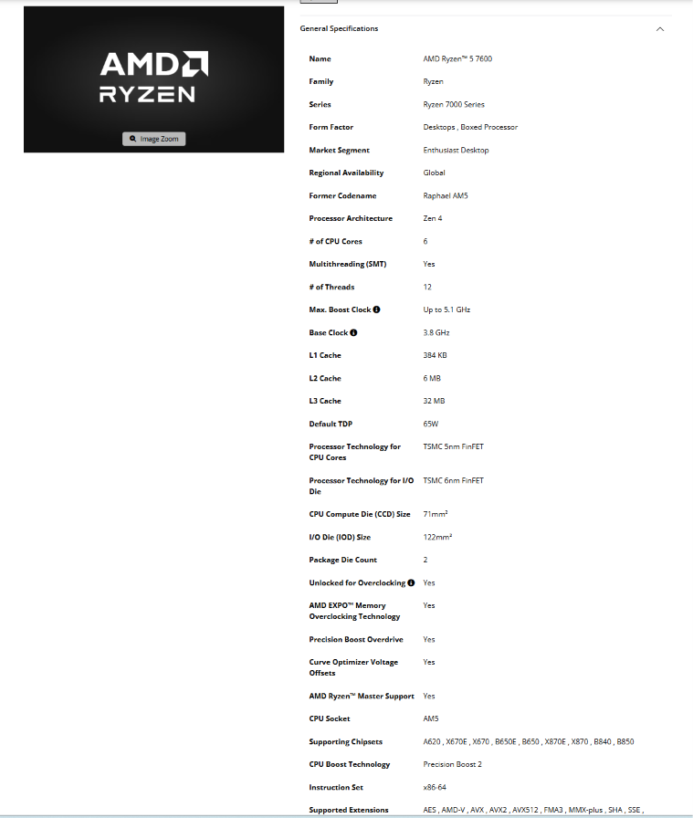

**What it is:** 6-core / 12-thread desktop CPU, Zen 4 architecture (Ryzen 7000 series, "Raphael AM5"), 3.8 GHz base / up to 5.1 GHz boost, 32 MB L3, 65 W TDP, built-in AMD Radeon graphics. Memory controller supports **DDR5 only**.
**Connects to:** an **AM5** socket on an AMD 600/800-series motherboard — AMD lists A620, X670E, X670, B650E, **B650**, X870E, X870, B840, B850. Memory goes through the board's DDR5 DIMM slots.
**Limits:** fits only AM5 boards; cannot use DDR4; max operating temperature (Tjmax) 95 °C. Unlocked for overclocking.
**Maker's page:** https://www.amd.com/en/products/processors/desktops/ryzen/7000-series/amd-ryzen-5-7600.html

#### Intel Core i5-13400
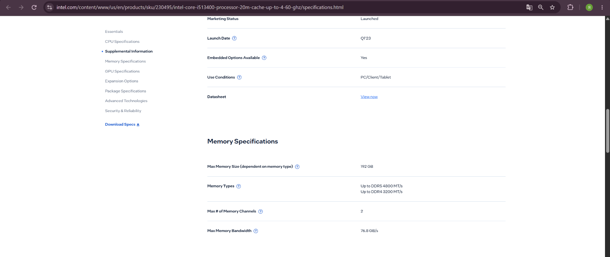
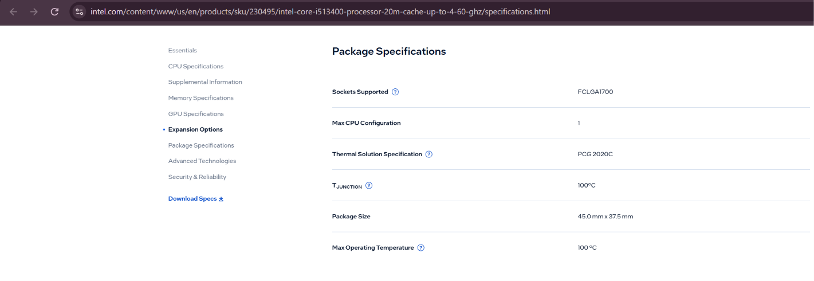

**What it is:** 13th-gen Intel Core (Raptor Lake, launched Q1 2023), 10 cores (6 Performance + 4 Efficient), 16 threads, 20 MB cache, 65 W base power, built-in Intel UHD Graphics 730.
**Connects to:** an **FCLGA1700** socket on an Intel 600- or 700-series motherboard (e.g. B760). Memory: **DDR4 up to 3200 MT/s or DDR5 up to 4800 MT/s**, 2 channels, up to 192 GB — which type depends on the motherboard.
**Limits:** fits only LGA 1700 boards; the "non-K" model is locked (no overclocking); with DDR5 it is officially limited to 4800 MT/s. Intel's page gives only the thermal specification (PCG 2020C); the boxed retail version (BX8071513400) includes Intel's stock cooler, the Laminar RM1.
**Maker's page:** https://www.intel.com/content/www/us/en/products/sku/230495/intel-core-i513400-processor-20m-cache-up-to-4-60-ghz/specifications.html

> **Which processor ships with a stock cooler?** Both — but only in the *boxed* retail versions. AMD's page lists **Thermal Solution (PIB): AMD Wraith Stealth** for the Ryzen 5 7600 (PIB = processor-in-box); the Core i5-13400 BOX comes with the **Intel Laminar RM1**. Tray/OEM versions come without a cooler.

### Motherboards

#### ASUS PRIME B650M-A
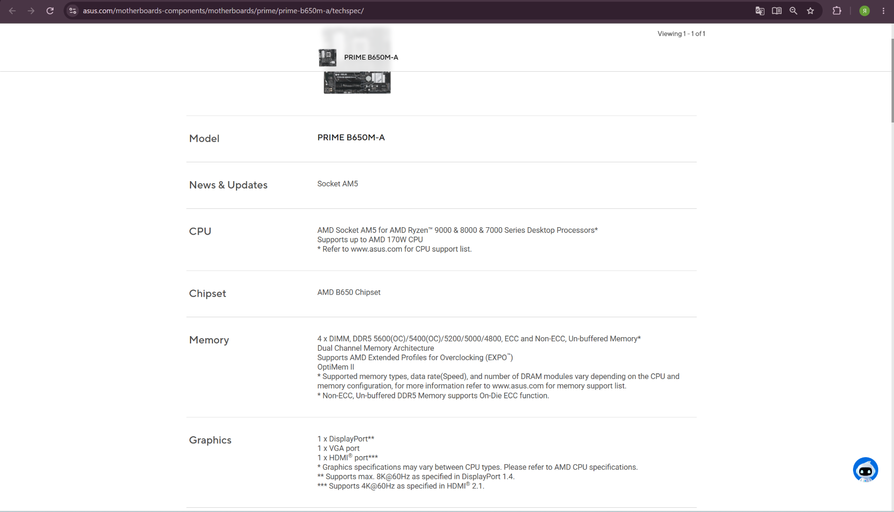

**What it is:** Micro-ATX motherboard for AMD.
**Connects to:** CPU in the **AM5** socket (CPUs up to 170 W); **4 × DDR5 DIMM** slots; M.2 NVMe SSDs; PSU via 24-pin ATX + 8-pin CPU power. Video outputs (1 × DisplayPort, 1 × HDMI, 1 × VGA) work with the CPU's integrated graphics.
**Limits:** AMD AM5 CPUs only; **DDR5 only**, 4800–5200 MT/s standard, 5400/5600 only as overclock; needs a case that takes Micro-ATX or larger.

| Socket | Chipset | Memory type | CPU generations accepted |
|---|---|---|---|
| AM5 | AMD B650 | DDR5, 4 × DIMM, dual channel, up to 5600 (OC), EXPO | AMD Ryzen 9000, 8000 and 7000 series desktop processors |

**Maker's page:** https://www.asus.com/motherboards-components/motherboards/prime/prime-b650m-a/techspec/

#### MSI PRO B760M-A WIFI DDR4
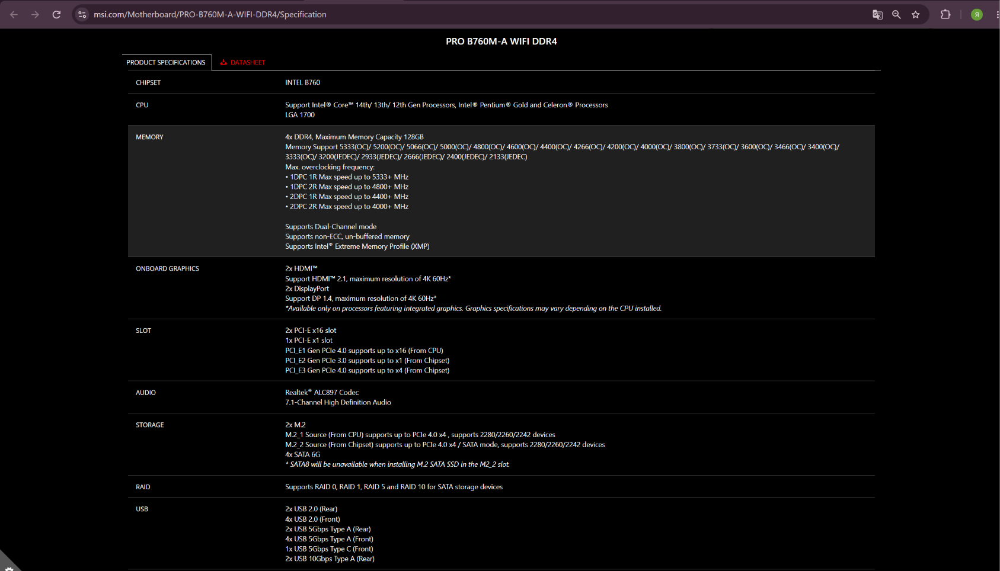

**What it is:** Micro-ATX motherboard for Intel, with Wi-Fi and 2.5G LAN.
**Connects to:** CPU in the **LGA 1700** socket; **4 × DDR4** slots (up to 128 GB); 2 × M.2 (PCIe 4.0 x4); **4 × SATA 6G**; PSU via 24-pin ATX + CPU power connectors. Video outputs (2 × HDMI 2.1, 2 × DisplayPort 1.4) work only with a CPU that has integrated graphics.
**Limits:** Intel LGA 1700 only; **DDR4 only** — DDR5 sticks will not fit. Memory runs 3200 MT/s by JEDEC, higher only with XMP overclocking (up to 5333).

| Socket | Chipset | Memory type | CPU generations accepted |
|---|---|---|---|
| LGA 1700 | Intel B760 | DDR4, 4 × DIMM, dual channel, 2133–3200 JEDEC / up to 5333 OC, XMP | Intel Core 14th, 13th and 12th gen, Pentium Gold, Celeron |

**Maker's page:** https://www.msi.com/Motherboard/PRO-B760M-A-WIFI-DDR4/Specification

### Memory

#### Kingston FURY Beast DDR5-5600, 16 GB (KF556C40BB-16)
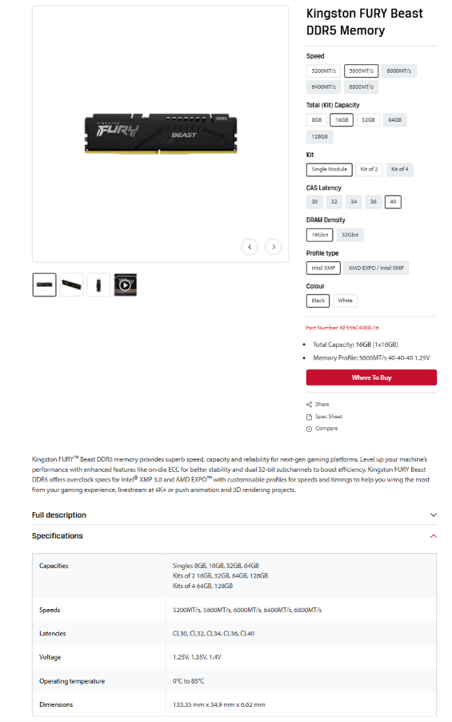

**What it is:** DDR5 desktop DIMM, part number **KF556C40BB-16**: 16 GB single module, 5600 MT/s, timings 40-40-40, 1.25 V, 16 Gbit DRAM chips. Profile type: **Intel XMP** (not the "AMD EXPO / Intel XMP" variant).
**Connects to:** a DDR5 DIMM slot on a desktop motherboard, one module per channel.
**Limits:** fits only DDR5 boards (the notch is in a different place than on DDR4). Its 5600 MT/s profile is an Intel XMP profile, so on an AMD board 5600 may need to be set in BIOS; without a profile it runs at the default JEDEC speed. One stick = single channel only.
**Maker's page:** https://www.kingston.com/en/memory/gaming/kingston-fury-beast-ddr5-memory (configuration: 5600 MT/s · 16 GB · Single Module · CL40 · Intel XMP · Black)

#### Crucial DDR4-3200, 16 GB UDIMM (CT16G4DFRA32A)
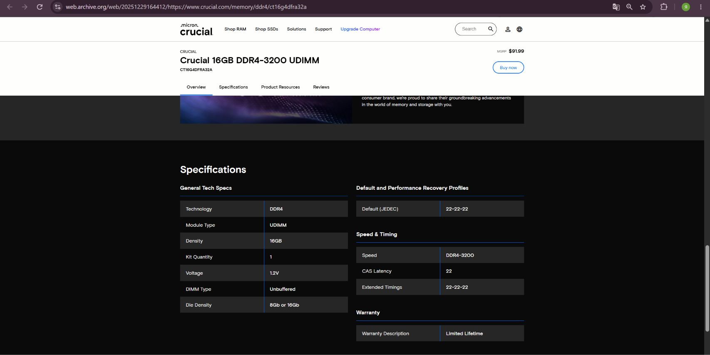

**What it is:** DDR4 desktop UDIMM, part number **CT16G4DFRA32A**: 16 GB, DDR4-3200, CL22 (22-22-22), 1.2 V, unbuffered, 1 module.
**Connects to:** a DDR4 DIMM slot on a desktop motherboard.
**Limits:** fits only DDR4 boards; it is a full-size UDIMM, so it does not fit laptop SO-DIMM slots. One stick = single channel only.
**Maker's page:** https://www.crucial.com/memory/ddr4/ct16g4dfra32a — the live page no longer loads its product data, so the screenshot is from the Wayback Machine copy of the same Crucial page (29 Dec 2025): https://web.archive.org/web/20251229164412/https://www.crucial.com/memory/ddr4/ct16g4dfra32a

### SSDs

#### Samsung 990 PRO 1 TB
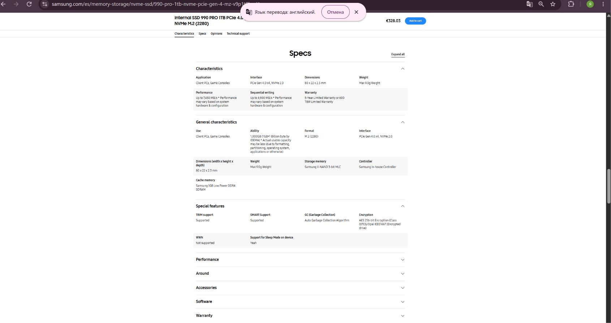

**What it is:** NVMe SSD, **M.2 (2280)** form factor (80 × 22 × 2.3 mm), **PCIe Gen 4.0 x4, NVMe 2.0**, up to 7450 MB/s read and 6900 MB/s write, Samsung in-house controller, 1 GB LPDDR4 cache.
**Connects to:** an **M.2 slot (M-key, 2280)** on the motherboard, wired to PCIe lanes. No cables needed.
**Limits:** needs an M.2 slot that supports NVMe/PCIe (not a SATA-only M.2 slot); in a PCIe 3.0 slot it runs at roughly half speed.
**Maker's page:** https://www.samsung.com/es/memory-storage/nvme-ssd/990-pro-1tb-nvme-pcie-gen-4-mz-v9p1t0bw/

#### Samsung 870 EVO 1 TB
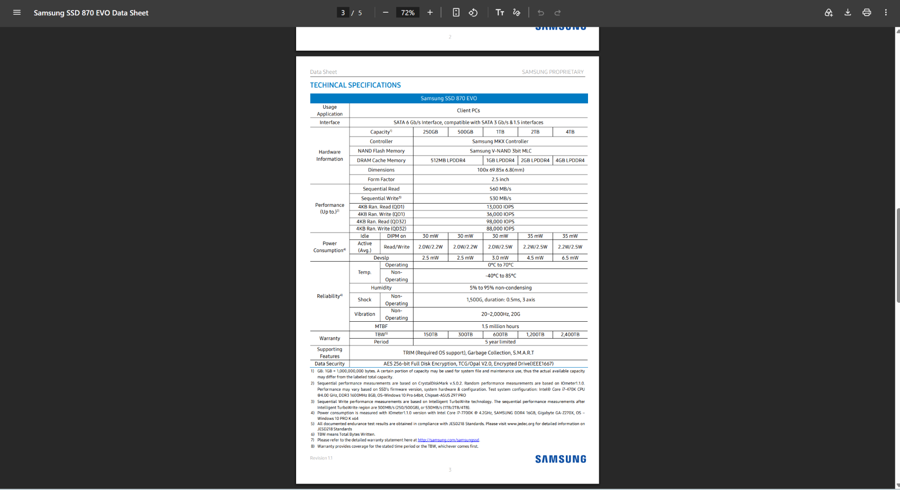

**What it is:** **2.5-inch SATA SSD** (100 × 69.85 × 6.8 mm), SATA 6 Gb/s, Samsung MKX controller, 1 GB LPDDR4 cache (1 TB model), up to 560 MB/s read and 530 MB/s write, 600 TBW.
**Connects to:** a **SATA port** on the motherboard (SATA data cable) + **SATA power** from the PSU; sits in a 2.5" bay of the case.
**Limits:** speed is capped by the SATA interface (~560 MB/s) — about 13× slower than the 990 PRO.
**Maker's page (data sheet):** https://download.semiconductor.samsung.com/resources/data-sheet/Samsung_SSD_870_EVO_Data_Sheet_Rev1.1_230509_10129500053000.pdf

### Power and cooling

#### Corsair RM750e (750 W)
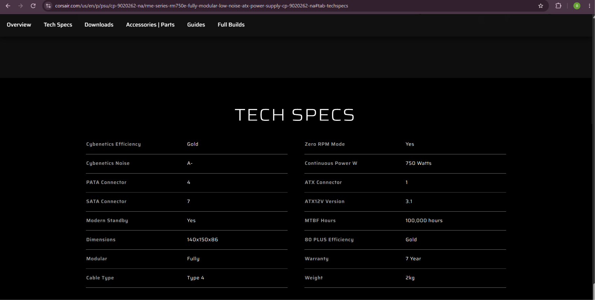

**What it is:** ATX power supply, **750 W continuous**, 80 PLUS Gold, fully modular cables (Type 4), ATX12V version 3.1, 140 × 150 × 86 mm.
**Connects to:** wall socket; inside the case — **1 × 24-pin ATX** connector to the motherboard, CPU power cable to the board's CPU_PWR header, **7 × SATA** power connectors for SATA drives, 4 × PATA (Molex) connectors, PCIe cables for a graphics card.
**Limits:** 750 W total; needs a case that takes an ATX PSU. There is **only one**, so only one of the two builds gets it.
**Maker's page:** https://www.corsair.com/us/en/p/psu/cp-9020262-na/rme-series-rm750e-fully-modular-low-noise-atx-power-supply-cp-9020262-na

#### Stock cooler — AMD Wraith Stealth (with Ryzen 5 7600 BOX)
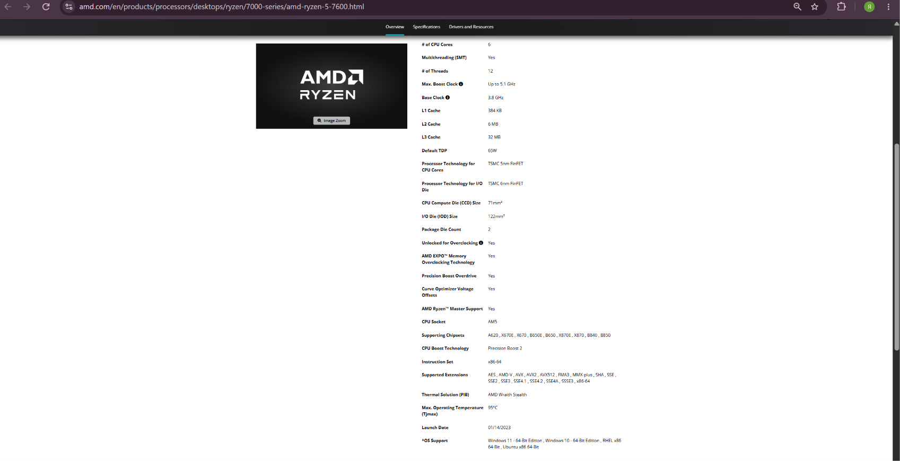

**What it is:** low-profile air cooler that AMD bundles in the Ryzen 5 7600 retail box — AMD lists it as **Thermal Solution (PIB): AMD Wraith Stealth**.
**Connects to:** sits on top of the CPU on the **AM5** mounting; its fan plugs into the CPU_FAN header on the motherboard.
**Limits:** designed for the 65 W CPU it ships with — enough at stock settings, weak for overclocking; AM4/AM5 mounting only.
**Maker's page:** same AMD page as the Ryzen 5 7600.

---

## Part 1b — Two computers that would work

The rule: **CPU socket = motherboard socket**, and **memory type = what the motherboard's slots take.**

| Part | Build A — AMD | Why here | Build B — Intel | Why here |
|---|---|---|---|---|
| CPU | Ryzen 5 7600 | AM5 CPU | Core i5-13400 | LGA 1700 CPU |
| Motherboard | ASUS PRIME B650M-A | AM5 socket; B650 is on AMD's supported-chipset list | MSI PRO B760M-A WIFI DDR4 | LGA 1700 socket; MSI lists 13th gen as supported |
| Memory | Kingston FURY Beast DDR5-5600 | B650M-A takes only DDR5; 5600 is the board's top (OC) speed | Crucial DDR4-3200 | B760M-A **DDR4** takes only DDR4; 3200 is exactly the i5-13400's official DDR4 speed |
| Storage | Samsung 990 PRO (M.2 NVMe) | fastest drive to the newest platform; no cables | Samsung 870 EVO (SATA) | board has 4 × SATA 6G ports |
| Cooler | Wraith Stealth (in the box) | AM5 mounting, matches 65 W | Laminar RM1 (in the i5 box) | LGA 1700 mounting, matches 65 W |
| PSU | Corsair RM750e | 24-pin ATX + CPU power; far more than the ~150 W this build draws | **missing** | — |
| Graphics | Radeon iGPU in the CPU | board has DP / HDMI / VGA outputs | UHD 730 iGPU in the CPU | board has HDMI / DP outputs |

**What each build still needs**

- **Build A (AMD):** a Micro-ATX (or larger) case, a second DDR5 stick for dual channel, an operating system.
- **Build B (Intel):** **a power supply** (ATX, 24-pin + CPU power — any decent 450 W+ unit), a SATA data cable for the 870 EVO, a Micro-ATX (or larger) case, a second DDR4 stick for dual channel, an operating system.

Neither build needs a graphics card — both CPUs have integrated graphics.

---

## Part 2 — The same facts from the command line

Raw outputs:
- [`evidence/windows-specs.txt`](evidence/windows-specs.txt) — **host laptop**, Windows 11, PowerShell (`Get-CimInstance`, `Get-PhysicalDisk`)
- [`evidence/linux-specs.txt`](evidence/linux-specs.txt) — **Ubuntu 26.04.1 LTS Server running as a VirtualBox VM** (`lab01-ubuntu`)

> ⚠️ The Linux output describes the **virtual machine**, not the laptop. VirtualBox gave it 2 CPUs, 2048 MB RAM and a 25 GB virtual disk — and that is exactly what Linux reports.
>
> macOS: no one in the pair has a Mac, so the macOS column lists the equivalent command for reference only (not run).

| Fact | Windows (PowerShell) | Linux (bash) | macOS (not run) |
|---|---|---|---|
| CPU model | `Get-CimInstance Win32_Processor` → `Name` = AMD Ryzen 7 7735HS with Radeon Graphics | `lscpu` → `Model name` = AMD Ryzen 7 7735HS with Radeon Graphics | `sysctl -n machdep.cpu.brand_string` |
| Cores / threads | `NumberOfCores` = **8**, `NumberOfLogicalProcessors` = **16** | `lscpu` → `CPU(s)` = **2**, `Core(s) per socket` = 2, `Thread(s) per core` = 1 | `sysctl hw.physicalcpu hw.logicalcpu` |
| Clock speed | `MaxClockSpeed` = 3201 (MHz, base clock) | not shown inside the VM (`lscpu` gives only `BogoMIPS` = 6387.98) | `sysctl hw.cpufrequency` (Intel Macs only) |
| Running in a VM? | — | `lscpu` → `Hypervisor vendor` = KVM, `Virtualization type` = full | — |
| Total RAM | `Get-CimInstance Win32_PhysicalMemory` → 4 × `Capacity` 4294967296 bytes = **16 GiB** | `free -h` → `total` = **1.6Gi** | `sysctl hw.memsize` |
| RAM type / speed | `SMBIOSMemoryType` = 35 (**LPDDR5**), `Speed` = 6400 (MT/s); `Manufacturer` = Micron | not shown by `free` (would need `sudo dmidecode -t memory`, and in a VM it reports virtual hardware) | `system_profiler SPMemoryDataType` |
| Disks | `Get-PhysicalDisk` → `SSSTC CL6-8D1024`, `MediaType` SSD, `Size` 1024209543168 bytes (≈1 TB) | `lsblk` → `sda` 25G `disk` (+ partitions sda1–sda3, LVM root 11.5G) | `diskutil list` |
| Disk interface | `BusType` = **NVMe** | not in default `lsblk` columns (`lsblk -o NAME,TRAN` would show it); the VM disk is attached to a virtual SATA controller | `system_profiler SPNVMeDataType` |

### What the comparison shows

1. **Same fact, different names.** Windows says `NumberOfLogicalProcessors`, Linux says `CPU(s)`; Windows says `Name`, Linux says `Model name`.
2. **Different units.** Windows gives memory and disk in raw **bytes** (4294967296, 1024209543168); Linux `free -h` / `lsblk` give human units (**Gi**, **G**).
3. **Codes instead of words.** Windows reports memory type as a number — `SMBIOSMemoryType 35` — which you have to look up in the SMBIOS standard (35 = LPDDR5).
4. **The VM sees the real CPU model but not the real resources.** Both OSes print *AMD Ryzen 7 7735HS*, but Windows sees 8 cores / 16 threads and 16 GiB, while the Ubuntu VM sees only the 2 CPUs and ~1.6 GiB it was given (part of the 2048 MB is reserved by the kernel). Linux even reports `Hypervisor vendor: KVM`.
5. **Back to Part 1:** the laptop's memory is **LPDDR5-6400 soldered to the board** (four Micron chips, no DIMM/SO-DIMM slots) — so unlike the desktop sticks above, it cannot be upgraded.

*Note: `windows-specs.txt` also lists a 32 MB `Msft Virtual Disk` (`BusType` File Backed Virtual) — a virtual disk image mounted by Windows, not a physical drive.*
