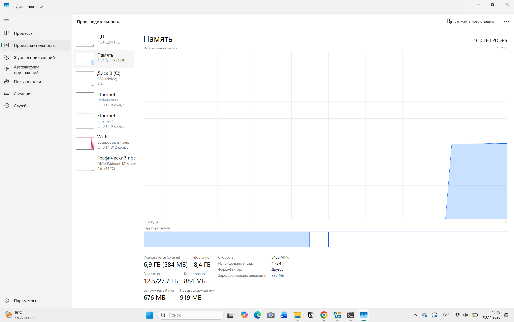
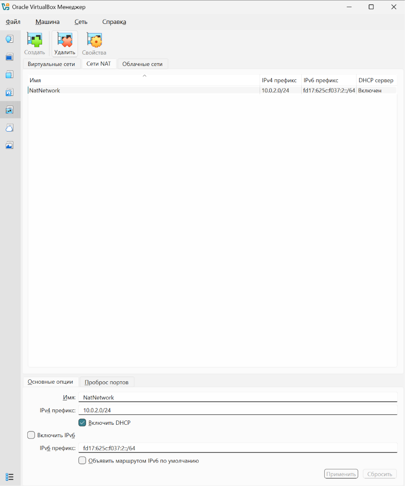
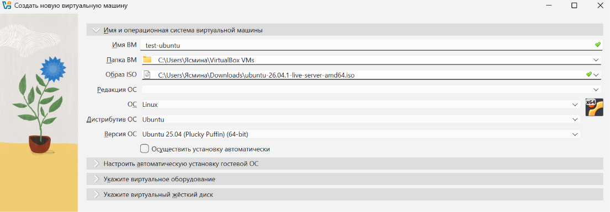
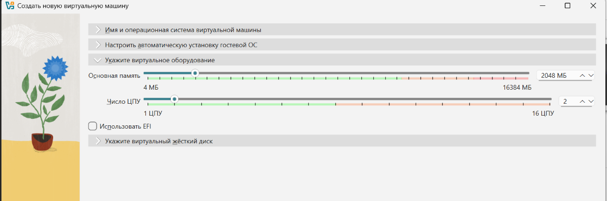
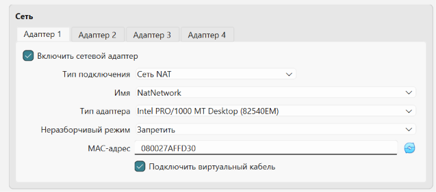
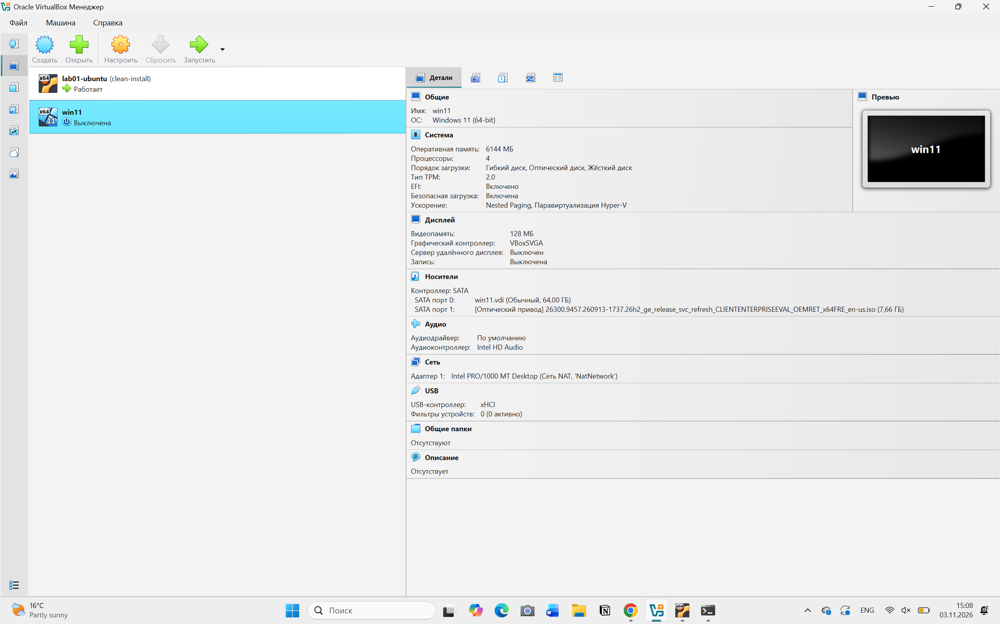
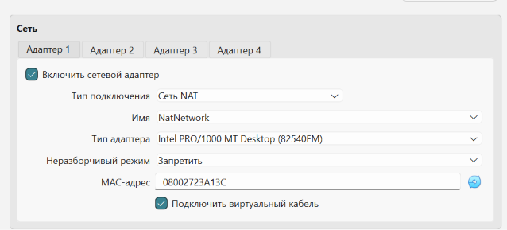
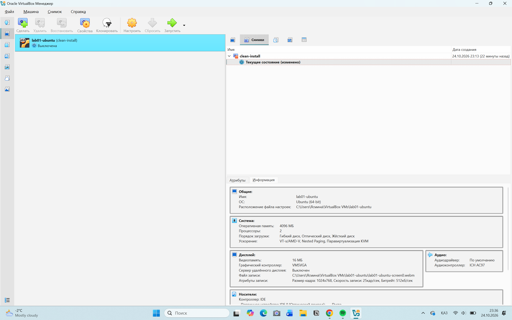

# How to build a test machine (Linux + Windows) in VirtualBox

**Who this is for:** someone who uses a computer every day but has never opened VirtualBox.
**Note on the screenshots:** they were taken in the Russian VirtualBox interface. Button names are given in English with the Russian label in brackets, e.g. **New** (Создать).

**What you get at the end:** two "computers inside your computer" — Ubuntu Linux and Windows 11 —
that can reach the internet and each other, plus a saved "clean" state you can return to in one click
if the new developer breaks something.
**Time:** about 2 hours, most of it waiting for downloads and installs.

Do the steps in order. Every step ends with a **Check** — if the check does not match, stop and look at
"If something goes wrong" at the end before continuing.

---

## Step 0. Check that this computer is big enough

Open **Task Manager** (Ctrl + Shift + Esc) → **Performance** → **Memory**. Close every program except
Task Manager first. Write down the number under **Available**.



| Available memory | What to build |
|---|---|
| 8 GB or more | both machines, and they can run at the same time |
| 4–8 GB | both machines, but run only **one at a time** |
| less than 4 GB | this computer is too small for Windows 11 — use another one |

Then open **This PC** and check that drive **C:** has at least **120 GB free**.

Why: the two machines together are promised 8 GB of memory (Windows 6 GB + Linux 2 GB). If the real
computer does not actually have that much free, it starts using the disk as memory and freezes — this
happened during testing (see the report). The disk needs 64 GB + 25 GB for the two machines, plus room
for the installers and for the computer itself.

> **Check:** you have written down the Available memory and the free space on C:.

## Step 1. Install VirtualBox

Go to **virtualbox.org → Downloads → Windows hosts**, run the installer, press **Next** on every screen
and **Yes** when Windows asks about network adapters. The network may disconnect for a few seconds —
that is normal.

Why VirtualBox and not Hyper-V (which is built into Windows): VirtualBox is free on every edition of
Windows, including Home, and works the same way on Mac and Linux, so these instructions stay valid
whatever computer the next person has.

> **Check:** VirtualBox opens and shows an empty list on the left.

## Step 2. Download the two installers

- **Ubuntu Server 26.04 LTS**: ubuntu.com → Download → Ubuntu Server → the `.iso` file (~3 GB).
- **Windows 11 Enterprise Evaluation**: search "Windows 11 Enterprise evaluation" on microsoft.com →
  Evaluation Center → ISO, 64-bit, English (~6 GB).

Why the *evaluation* version of Windows: it is free and legal for testing without a licence key, but it
**stops working after 90 days**. If the developer will use the machine longer than that, the company has to
buy a licence. "LTS" for Ubuntu means it gets security updates for 5 years.

> **Check:** two `.iso` files are in your Downloads folder.

## Step 3. Create the shared network (do this once)

In VirtualBox: **File → Tools → Network Manager** (Файл → Инструменты → Менеджер сетей) → **NAT Networks** tab (Сети NAT) → **Create** (Создать).
Leave the name **NatNetwork**, set **IPv4 Prefix** (IPv4 префикс) to `10.0.2.0/24`, tick **Enable DHCP** (Включить DHCP), press **Apply** (Применить).
Careful: the first tab, *Host-only Networks* (Виртуальные сети), looks similar but is a different network — make sure you are on **NAT Networks**.



Why a *NAT Network* and not the default *NAT*: with plain NAT each machine sits alone in its own little
network and cannot see the other one. *NAT Network* puts both machines in the same network and still
lets them reach the internet through your computer. *Bridged* would also work at home, but on office or
university Wi-Fi the network often refuses unknown devices, so the machines would lose internet.

> **Check:** NatNetwork appears in the list.

## Step 4. Create the Linux machine

Click **New** (Создать). Fill in:

| Field | Value |
|---|---|
| Name (Имя ВМ) | `test-ubuntu` |
| ISO Image (Образ ISO) | the Ubuntu `.iso` from Step 2 |
| Unattended installation (Осуществить установку автоматически) | **unticked** — in some versions this is a box called *Skip Unattended Installation*, which must be **ticked**; both mean "do not install automatically" |
| Base Memory (Основная память) — in the section *Hardware* (Укажите виртуальное оборудование) | **2048 MB** |
| Processors (Число ЦПУ) | **2** |
| Enable EFI (Использовать EFI) | unticked |

VirtualBox may show *Ubuntu 25.04* as the OS version for a 26.04 ISO — that is fine, leave it.




Why 2048 MB and 2 processors: Ubuntu *Server* has no desktop, so 2 GB is plenty, and the less it takes the
more is left for Windows and for you. Unattended installation is skipped because it sometimes creates a
user without admin rights, which then has to be fixed by hand.

> **Check:** the wizard moves on to the disk page.

## Step 5. Linux disk

Open the section **Hard Disk** (Укажите виртуальный жёсткий диск), choose **Create a Virtual Hard Disk Now** (Создать новый виртуальный жёсткий диск), set **Disk Size** (Размер диска) to **25 GB**, leave **Pre-allocate Full Size** (Выделить место заранее в полном размере) **unticked**.


Why not pre-allocated: an un-preallocated ("dynamic") disk only takes the space that is actually used —
about 5 GB after installation instead of 25 GB at once. It is slightly slower, which does not matter for a
test machine.

> **Check:** `test-ubuntu` is in the list on the left, state *Powered Off*.

## Step 6. Connect the Linux machine to the shared network

Select `test-ubuntu` → **Settings** (Настроить) **→ Network** (Сеть) **→ Adapter 1** (Адаптер 1) → **Attached to** (Тип подключения): **NAT Network** (Сеть NAT),
**Name** (Имя): **NatNetwork** → **OK**. Leave *Cable Connected* (Подключить виртуальный кабель) ticked.



Why: by default a new machine gets plain NAT (see Step 3) and could never see the Windows machine.

> **Check:** Settings → Network shows *NAT Network (NatNetwork)*.

## Step 7. Install Ubuntu

Press **Start**. In the installer press **Enter** on every screen, except:

- **Profile setup:** your name, server name `test-ubuntu`, user name and a password you **write down**.
- **SSH Setup:** tick **Install OpenSSH server** (Space, then Enter).

When it says **Reboot Now**, press Enter. If it asks to "remove the installation medium", just press Enter.

Why OpenSSH: it lets you copy text out of the machine later instead of retyping it from the screen.

> **Check:** after the reboot you see `test-ubuntu login:`. Log in, type `uname -a` and press Enter —
> you should see a line beginning with `Linux test-ubuntu`.

Expected output: [evidence/04-guest-uname.txt](evidence/04-guest-uname.txt)

## Step 8. Create the Windows machine

Click **New** again:

| Field | Value |
|---|---|
| Name | `test-win11` |
| ISO Image | the Windows `.iso` from Step 2 |
| Skip Unattended Installation | **ticked** |
| Base Memory | **6144 MB** |
| Processors | **4** |
| Enable EFI | **ticked** (VirtualBox ticks it for Windows 11 — leave it) |
| Hard Disk | **64 GB**, Pre-allocate **unticked** |

Then **Settings → System → Motherboard**: check **TPM: v2.0** and **Enable Secure Boot**.
**Settings → Network → Adapter 1 → NAT Network → NatNetwork** (as in Step 6).




Why these numbers: Windows 11 refuses to install with less than 4 GB of memory; 6 GB makes it usable
rather than barely starting. Windows 11 also refuses to install without TPM 2.0 and Secure Boot — that is
why this is *not* "nothing special". 4 processors out of 16 leaves the real computer plenty.
If Step 0 showed less than 8 GB available, give it **4096 MB** and never run both machines together.

> **Check:** Settings → System shows 6144 MB, 4 processors, TPM v2.0, Secure Boot ticked.

## Step 9. Install Windows

Press **Start**, then press any key when you see "Press any key to boot from CD". Choose
**I don't have a product key**, **Windows 11 Enterprise Evaluation**, **Custom install**, the empty disk.
When it asks for a Microsoft account choose **Sign-in options → Domain join instead** and create a local
user with a password you **write down**.

Why a local account: it does not need an email address, and the test machine is not tied to anyone's
personal Microsoft account.

> **Check:** you reach the Windows desktop.

## Step 10. Guest Additions (makes copy-paste work)

In the window of the running Windows machine: **Devices → Insert Guest Additions CD image**.
Open **This PC → CD drive → VBoxWindowsAdditions**, install with defaults, restart.
Then **Devices → Shared Clipboard → Bidirectional**.

Why: without this, the mouse gets "stuck" inside the window and you cannot copy text between your
computer and the test machine.

> **Check:** the Windows window resizes when you resize it.

## Step 11. Allow ping into Windows

Windows blocks ping from other machines by default. In the Windows machine: right-click **Start →
Terminal (Admin)**, paste and press Enter:

```powershell
New-NetFirewallRule -DisplayName "Allow ICMPv4 Echo In" -Protocol ICMPv4 -IcmpType 8 -Direction Inbound -Action Allow -Profile Any
```

Why one rule and **not** "turn the firewall off": this lets only ping through and keeps everything else
protected. `-Profile Any` is needed because Windows calls this network *Public* and would otherwise
ignore a rule for *Private* networks.

> **Check:** the command prints a block of text with `Enabled : True`.

## Step 12. Test that both machines see each other and the internet

In **Windows** (Terminal): type `ipconfig` and find **IPv4 Address** (e.g. `10.0.2.4`).
In **Ubuntu**: type `ip addr` and find `inet 10.0.2.x` (e.g. `10.0.2.3`).

Then:

| On | Type | Should see |
|---|---|---|
| Ubuntu | `ping -c 4 <Windows address>` | `4 received, 0% packet loss` |
| Ubuntu | `ping -c 4 google.com` | `4 received` |
| Windows | `ping -n 4 <Ubuntu address>` | `Received = 4, Lost = 0` |
| Windows | `ping -n 4 google.com` | `Received = 4` |

Expected output: [evidence/05-ping-between-guests.txt](evidence/05-ping-between-guests.txt)

> **Check:** all four lines show zero loss. If the first one shows 100 % loss, go back to Step 11.

## Step 13. Save a clean state (snapshot)

Shut both machines down (**Ubuntu:** `sudo poweroff`; **Windows:** Start → Power → Shut down).
In VirtualBox select each machine → the **≡** button next to its name → **Snapshots** → **Take** →
name it `clean-install`.



Why: this is the whole point of a *test* machine. Whatever the developer breaks, you can return to this
exact state in a minute instead of reinstalling for an hour.

> **Check:** `clean-install` appears in the snapshot list of both machines.

## Step 14. When the developer breaks something

Shut the machine down → **Snapshots** → select `clean-install` → **Restore** → untick
"Create a snapshot of the current state" → **Restore** → **Start**.

> **Check:** the machine starts as it was right after Step 13.

---

## If something goes wrong

| What you see | What to do |
|---|---|
| Windows install says "This PC can't run Windows 11" | Step 8: TPM v2.0 and Secure Boot not set, or memory under 4096 MB |
| Ubuntu → Windows ping 100 % loss | Step 11 was skipped or run in a non-admin terminal |
| The machines get addresses like `10.0.2.15` and cannot see each other | Adapter is plain *NAT*, not *NAT Network* — repeat Step 6 for both |
| The whole computer becomes very slow or freezes | Too much memory given away. Shut one machine down; lower memory per Step 0 |
| VirtualBox says "VT-x/AMD-V is not available" | Virtualization is off in the computer's BIOS — ask IT to switch it on |
